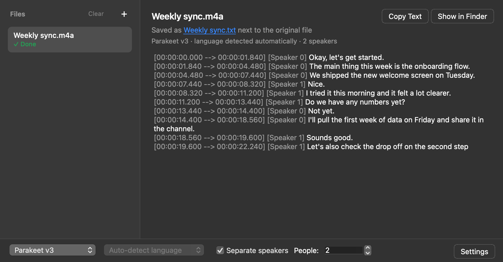
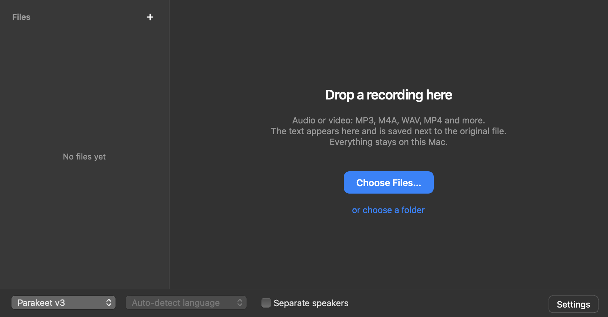
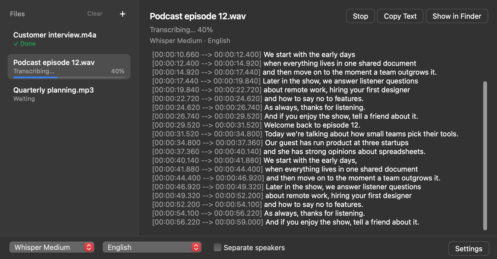
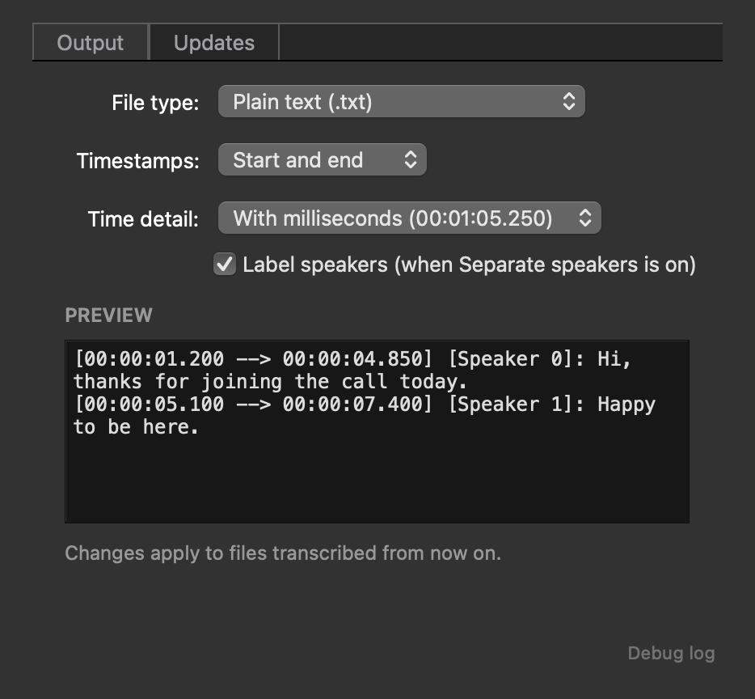

# UIWhisperCPP

**A desktop native app for transcribing audio files. Runs locally, no cloud, no API keys.**



<table>
  <tr>
    <td></td>
    <td></td>
    <td></td>
  </tr>
  <tr>
    <td align="center">Drop a recording or choose files</td>
    <td align="center">Text shows up while it works</td>
    <td align="center">Pick your output format</td>
  </tr>
</table>

---

UIWhisperCPP puts local speech-to-text engines ([whisper.cpp](https://github.com/ggerganov/whisper.cpp) and [Parakeet](https://github.com/senstella/parakeet-mlx)) behind a simple Qt window. Drop your files in and you get transcripts back.
Everything runs on your Mac, and your audio never leaves it.

## What it does

- Transcribes almost any audio or video file: WAV, MP3, M4A, WMA, FLAC, OGG/Opus, AAC, AIFF, MP4, MOV, MKV and more. Drop files or whole folders onto the window and it goes through them one by one.
- Lets you pick the model. Parakeet v3 is the default (fast and accurate, Apple Silicon only). Whisper comes in Base, Small, Medium and Large v3.
- Lets you set the language for Whisper, or leave it on Auto-detect. Parakeet detects the language by itself, so the menu is greyed out while it's selected.
- Can separate speakers. Tick "Separate speakers" and each line gets a `[Speaker 0]`, `[Speaker 1]` tag, so a conversation reads as a back-and-forth. If you know how many people are talking, set the count for the best result (it defaults to 2; pick "Not sure" otherwise). This runs as a local [pyannote](https://github.com/pyannote/pyannote-audio) ONNX pipeline, with no HuggingFace account or API key.
- Shows progress as it works. Each file shows its progress in the list, the transcript fills in on the right, and Stop keeps whatever was transcribed so far.
- Saves the transcript next to the original file. If that name is already taken, it asks whether to replace the old file or keep both (the new one becomes "name (2).txt").
- Lets you choose the output format in Settings (`⌘,`): start and end times, start only or no timestamps, milliseconds or whole seconds, speaker labels on or off, and plain `.txt` or `.srt` subtitles, with a live preview. The default is `[HH:MM:SS.mmm --> HH:MM:SS.mmm]: text`, with `[Speaker N]` added when speaker separation is on.
- Updates itself. Settings > Updates checks the GitHub releases of this repo (you can point it at another one), downloads the new version with progress and restarts into it. Downloads are checked against GitHub's checksum and the app's signature before anything is replaced.
- Has a debug log for when something goes wrong. Open it from the small link in Settings or Help > Debug Log (⌥⌘L). It shows the raw program output and is also saved to `~/Library/Logs/UIWhisperCPP/app.log`.
- Works offline once a model has been downloaded.

## Getting started

### Download

Grab `UIWhisperCPP.app.zip` from the [latest release](https://github.com/olchyk98/UIWhisperCPP/releases/latest), unzip it and move the app to Applications. From 2.0 on, the app updates itself.

### Requirements

- macOS 15 (Sequoia) or newer for the packaged app. On older versions it shows a message saying so instead of crashing.
- An Apple Silicon Mac for Parakeet. Whisper runs on Intel Macs too.
- Python 3.11+ and [uv](https://docs.astral.sh/uv/) (or pip), only when running from source. From source, Parakeet installs itself on first use if it's missing.

> FFmpeg is bundled via [imageio-ffmpeg](https://github.com/imageio/imageio-ffmpeg), so you don't need to install it.

### Install from source

```bash
git clone https://github.com/olchyk98/UIWhisperCPP.git
cd UIWhisperCPP

# using uv (recommended)
uv sync

# or using pip
pip install -e .
```

### Run

```bash
# if installed with uv
uv run app
```

The first time you use a model, the app downloads it (Parakeet v3 is about 2.5 GB) and shows the progress next to the file. How long that takes depends on your connection; after that the model is stored locally. Speaker separation also downloads two small models the first time you use it, from public sources with no HuggingFace login.

## How it works

1. You drop audio files on the window (or pick them with Choose Files).
2. The audio is checked and resampled to 16 kHz, which is what the models expect.
3. The selected engine transcribes it locally: whisper.cpp for Whisper, MLX for Parakeet.
4. Text comes back piece by piece and shows up in the window as it arrives.
5. The transcript is saved next to the original file, in the format chosen in Settings.

With Separate speakers on, a second pass runs after transcription. A local pyannote diarization pipeline (plain [ONNX Runtime](https://onnxruntime.ai/), no PyTorch) works out who spoke when, and each line is tagged with the matching speaker. It uses word-level timestamps, so a long stretch where two people talk is split at the right word instead of landing under one label. This pass runs in a separate process so the window stays responsive. If it fails, the transcript is still saved, just without speaker labels.

Behind all of this is a small abstraction layer (`uiwhispercpp.models`). Each engine implements a common `Model` interface, and one `ModelManager` lists the available models and runs transcription. Adding a model from another package means writing a new `Model` and registering it with the manager; nothing else in the app has to change.

## Built with

- [whisper.cpp](https://github.com/ggerganov/whisper.cpp): fast C++ inference for OpenAI's Whisper model
- [pywhispercpp](https://github.com/abdeladim-s/pywhispercpp): Python bindings for whisper.cpp
- [parakeet-mlx](https://github.com/senstella/parakeet-mlx): NVIDIA Parakeet models on Apple Silicon via MLX
- [pyannote-audio](https://github.com/pyannote/pyannote-audio) models with [ONNX Runtime](https://onnxruntime.ai/): offline speaker diarization without PyTorch
- [soxr](https://github.com/dofuuz/python-soxr): audio resampling
- [PySide6](https://doc.qt.io/qtforpython-6/): Qt for Python
- [imageio-ffmpeg](https://github.com/imageio/imageio-ffmpeg): bundled FFmpeg for audio decoding
- [uv](https://docs.astral.sh/uv/): Python package management

## License

[AGPL-3.0](LICENSE)
